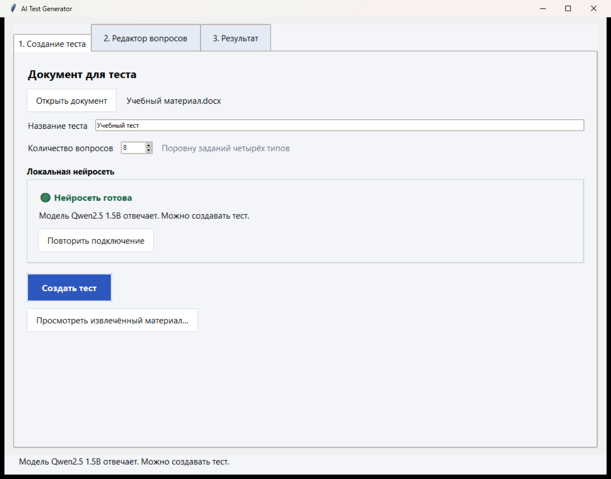
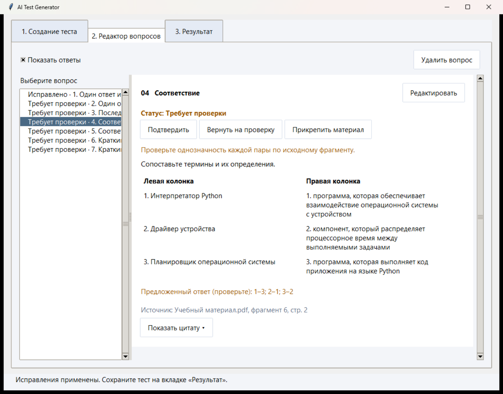
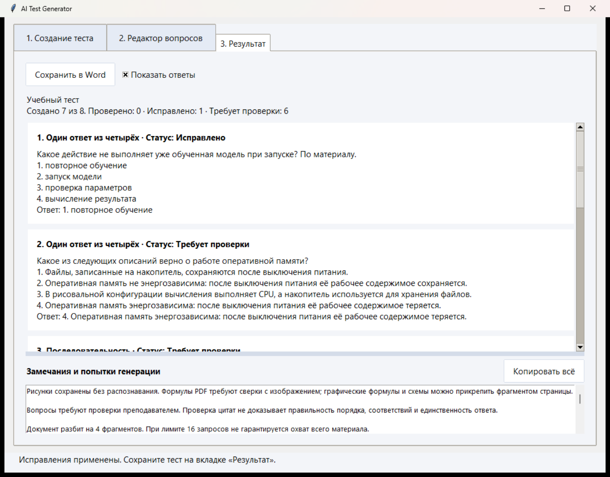

# AI Test Generator

[Скачать готовую программу](https://github.com/tiktox1c/IDBm11_lab-1/releases) · [Преподавателю: как проверить работу](docs/teacher-guide.md) · [Учебный PDF](examples/sample_material.pdf) · [Учебный DOCX](examples/sample_material.docx)

Небольшая учебная программа для дисциплины «Программно-аппаратное обеспечение искусственного интеллекта». Создаёт задания по вашему документу с помощью **одной локальной модели Qwen2.5 1.5B через Ollama**. Во время генерации документ и вопросы не отправляются в облако.

По умолчанию программа пытается создать восемь вопросов: по два с выбором одного ответа из четырёх, на последовательность, на соответствие и с кратким ответом. Это помощник преподавателя: каждый вопрос нужно проверить. Если сведений недостаточно или ответ модели не проходит проверку, вопросов может получиться меньше.

## Самый простой способ: автономный установщик Windows

Откройте [**Releases**](https://github.com/tiktox1c/IDBm11_lab-1/releases) справа на странице репозитория. В **Assets** скачайте **`AI-Test-Generator-Setup.zip`**. Распакуйте его через «Извлечь всё»; внутри находится `AI-Test-Generator-Setup.exe`. Это полный комплект: программа, Python с библиотеками, Ollama для CPU и единственная модель Qwen2.5 1.5B. Текущая версия установщика — **1.0.1**. Размер установщика — около 1 ГБ. Если на системном диске мало места, сохраните сам Setup.exe на другом диске через «Сохранить как». Интернет при установке и генерации не требуется. Не выбирайте архив Source code, если вам нужна готовая программа.

1. Распакуйте `AI-Test-Generator-Setup.zip`, дважды щёлкните находящийся внутри `AI-Test-Generator-Setup.exe` и прочитайте лицензию.
2. Выберите папку приложения на диске, где есть свободное место и разрешена запись. Не выбирайте папку исходного проекта или Program Files.
3. На странице **«Ollama и модель»** выберите отдельные папки Ollama и модели. По умолчанию они находятся внутри папки приложения. Модель занимает около 1 ГБ, весь установленный комплект — около 1,1 ГБ; для установки оставьте запас не менее 3 ГБ на выбранном диске.
4. Мастер проверит выбранное хранилище по контрольным суммам; на это может потребоваться несколько секунд. Полная существующая модель используется повторно, без второй копии. Существующая Ollama также может быть использована, если найдены все необходимые файлы комплектного CPU runtime; для неполного или другого состава выберите новую папку. Повреждённые файлы не перезаписываются: выберите другую папку.
5. По желанию отметьте создание ярлыка на рабочем столе. Нажмите **«Установить»**, затем запустите программу.
6. Для дальнейшего запуска используйте ярлык или `AI Test Generator.exe` в выбранной папке. Python, терминал и отдельная загрузка модели для этого комплекта не нужны.

Пути сохраняются в `installation.ini` рядом с EXE. Мастер не меняет PATH, глобальные переменные Windows и автозапуск. Модель передаётся только запускаемому приложением серверу через его окружение. Если уже работающая Ollama использует другую папку и не видит модель, закройте её через значок в области уведомлений и нажмите **«Повторить подключение»**. Программа не останавливает чужой сервер и не запускает второй на том же адресе.

На странице выбора папки показывается размер всего нового комплекта — около 1,1 ГБ. На последней странице сумма новых файлов учитывает уже имеющиеся Ollama и модель. Размер файла Setup.exe отличается от места после установки из-за упаковки.

Для удаления запустите `unins000.exe` из папки приложения: запись в список установленных программ Windows не создаётся. Ollama, модели и созданные пользователем документы при удалении сохраняются. При необходимости удалите их папки самостоятельно после закрытия приложений. Не перемещайте установленный комплект по частям: абсолютные пути Ollama и модели записаны в `installation.ini`; для нового расположения повторите установку.

Сборка не подписана цифровой подписью; Windows может показать предупреждение о неизвестном издателе. Проверяйте источник и SHA256 из релиза. Не отключайте защиту Windows ради непроверенного файла. На чистом компьютере комплект ещё не проверен: фактические проверки описаны в RELEASE_NOTES.md.

### Облегчённый ZIP

Если Ollama и модель уже настроены, можно скачать `AI-Test-Generator-Windows-x64.zip`, нажать **«Извлечь всё»** и запустить `AI Test Generator.exe`. Рядом должна оставаться папка `_internal`; перемещайте всю папку целиком. В этот ZIP Ollama и веса не входят, их установка описана ниже. Не запускайте EXE прямо из архива.

Если нужен исходный код, используйте Code → Download ZIP. Готовый установщик публикуется отдельно в Releases.

## Ollama и модель

Для запуска из исходников или облегчённого ZIP Ollama устанавливается отдельно с официальной страницы: https://ollama.com/download/windows . Программа сама не устанавливает системные компоненты и не меняет настройки Windows.

После установки Ollama запустите AI Test Generator. Программа проверит локальный сервер `127.0.0.1:11434`, при необходимости попробует запустить установленную Ollama без лишнего консольного окна и проверит модель `qwen2.5:1.5b`. Второй сервер при уже работающей Ollama не запускается. Процессы Ollama при выходе из программы не завершаются.

Если модель отсутствует, нажмите **«Загрузить модель»**. Перед скачиванием программа запросит согласие. Загрузка выполняется штатным локальным API Ollama, состояние показывается внизу окна. Потребуется интернет и около 1 ГБ места для весов. Для самой генерации интернет не нужен. Можно установить модель вручную: откройте Терминал/PowerShell и выполните:

```powershell
ollama pull qwen2.5:1.5b
```

Использовать другие модели в этой программе нельзя. Если загрузка прервалась, проверьте сеть и свободное место, затем повторите: Ollama обычно продолжает загрузку уже начатых слоёв.

### Как хранить веса на другом диске

Настройте каталог **до первой загрузки**. По умолчанию Ollama использует профиль пользователя на системном диске.

1. Создайте папку для моделей на выбранном диске.
2. Через поиск Windows откройте «Изменение переменных среды текущего пользователя».
3. В пользовательских переменных добавьте `OLLAMA_MODELS`, значением укажите полный путь к созданной папке.
4. Полностью завершите Ollama через её значок в области уведомлений и запустите заново. Закройте и снова откройте AI Test Generator и терминал.
5. После этого загрузите модель кнопкой программы или командой выше.

Важно: каталог определяется окружением **серверного процесса Ollama**. Изменение переменной не переносит старые веса и не меняет каталог уже работающего сервера. Программа не изменяет эту переменную за вас.

Полной изоляции от диска C: нет. Windows, Word, Python, Ollama, установщики и само приложение Codex могут использовать профиль, AppData, журналы и файл подкачки. Временные файлы AI Test Generator сохраняются в подпапке `temp` рядом с приложением; журналы — в `logs`. Не удаляйте `temp`, пока открыт тест с вложениями. После закрытия приложения содержимое `temp` можно удалить вручную. Оно может содержать извлечённые части ваших документов: не публикуйте эту папку.

## Скриншоты

На скриншотах использован подготовленный учебный материал, без личных документов и путей.







## Какие документы поддерживаются

| Формат | Что необходимо |
|---|---|
| PDF с текстовым слоем | Дополнительные программы не нужны |
| DOCX | Дополнительные программы не нужны |
| Старый DOC | Установленный Microsoft Word; приложение работает с временной копией |

Исходный документ открывается для чтения и не перезаписывается. При сохранении нельзя выбирать исходный файл в качестве результата.

### Таблицы

В DOCX читаются строки, столбцы и доступные заголовки. PDF использует обнаружение таблиц PyMuPDF по линиям границ. Табличный текст не дублируется поверх обычного текста страницы. Для надёжных таблиц сохраняется связь заголовков со значениями; вопрос может получить такую таблицу во вложении и экспортировать её как таблицу Word.

Таблицы без видимых границ, сложные объединения, вложенные структуры и нестандартный порядок чтения могут определяться неоднозначно. Неоднозначные таблицы доступны для просмотра, но исключаются из автоматических оснований. В таком случае используйте изображение нужного фрагмента страницы и ручную проверку. При ненадёжном распознавании таблицы PDF вся затронутая страница консервативно исключается из генерации, но остаётся в просмотре.

### Рисунки и схемы

Доступные встроенные изображения PDF/DOCX сохраняются во временной папке. Просмотр загружает только выбранное изображение; оригинал не уменьшается ради предпросмотра. Векторные схемы PDF и графические формулы доступны через изображение страницы: выделите мышью нужную область и прикрепите её к вопросу.

**Qwen2.5 1.5B не видит пиксели.** Она использует подписи и соседний извлечённый текст. Без текстовых сведений рисунок можно использовать только как иллюстрацию, а его содержание нужно оценить вручную. OCR и вторая модель отсутствуют.

### Формулы

Для DOCX сохраняется исходный OfficeMath/OMML. Простые дроби, степени, индексы и корни преобразуются в читаемую запись; исходная OMML переносится в Word как редактируемая формула. Неподдерживаемая конструкция остаётся доступной для сохранения и ручной проверки, но не передаётся модели как надёжный факт.

В PDF доступный математический текст сохраняется буквально. Для найденных выражений сохраняется и изображение; индексы, переносы и математические символы нужно сверять с оригиналом. Автоматическая классификация выражений консервативная и не заменяет проверку преподавателя. Графические и векторные формулы можно прикрепить как фрагмент страницы. Полноценной символьной математики нет. Текстовые поля, колонтитулы, SmartArt и некоторые старые объекты Word могут быть недоступны.

## Как создать и проверить тест

1. На первой вкладке нажмите **«Открыть документ»** и выберите PDF, DOCX или DOC.
2. Укажите название теста. По умолчанию создаётся 8 вопросов; также доступны 4, 12, 16 и 20, поровну каждого типа.
3. При необходимости нажмите **«Просмотреть извлечённый материал»**. В окне перечислены типы элементов, их источник и возможность использования для генерации. Полный текст и выбранные фрагменты доступны на отдельных вкладках.
4. Дождитесь состояния **«Нейросеть готова»** и нажмите **«Создать тест»**. Генерация выполняется в фоне; не закрывайте приложение до завершения.
5. В редакторе выберите вопрос слева. Включите **«Показать ответы»**, раскройте цитату и сравните вопрос и ключ с источником.
6. Если всё верно, нажмите **«Подтвердить»**. Только это действие устанавливает статус **«Проверено»**. Успешный JSON-ответ модели и автоматическая проверка структуры не подтверждают смысл.
7. Для исправления нажмите **«Редактировать»**, измените формулировку, варианты или ключ, затем **«Сохранить исправление»**. Статус станет **«Исправлено»**. Если обязательные поля повреждены, программа покажет конкретную причину.
8. Повторное изменение подтверждённого вопроса сбрасывает подтверждение. Отмена редактирования возвращает исходные данные. При переходе с несохранёнными изменениями программа предложит сохранить их, отменить или остаться в редакторе.
9. Кнопка **«Вернуть на проверку»** снимает подтверждение. Новые вопросы имеют статус **«Требует проверки»**.
10. Чтобы добавить рисунок, формулу или таблицу, выберите вопрос и нажмите **«Прикрепить материал»**. Выберите элемент в просмотре и нажмите **«Прикрепить к текущему вопросу»**. Добавление вложения требует повторной проверки вопроса. Для страницы PDF можно выделить фрагмент мышью.
11. Откройте вкладку **«Результат»**. Здесь показаны карточки заданий, статусы и число проверенных, исправленных и требующих проверки вопросов. При включённых ответах видны ключи.
12. Нажмите **«Сохранить в Word»** и выберите файл `.docx`. Он содержит актуальные вопросы, вложения, статусы и отдельный раздел ответов. Формат страницы — A4. Не подтверждённые вопросы тоже можно сохранить: их статус остаётся явно указанным.

JSON остаётся внутренним форматом обмена с моделью и диагностических данных. Кнопок JSON-экспорта нет. Редактор не восстанавливает тест после закрытия или аварии: сохраняйте итоговый Word-файл перед выходом.

## Если что-то не работает

- **«Ollama не найдена»** — установите её с официального сайта, затем нажмите «Повторить подключение». Кнопка сайта доступна в программе.
- **«Модель не установлена»** — загрузите строго `qwen2.5:1.5b`. Перед загрузкой проверьте каталог моделей и свободное место.
- **«Ошибка подключения»** — запустите Ollama и повторите подключение. Проверка недоступного сервера занимает несколько секунд; ожидание запуска сервера ограничено 20 секундами. Для вычисления вопросов предусмотрен отдельный длительный таймаут.
- **Меньше восьми вопросов** — модель отказалась или выдала некорректные данные. Причины указаны на вкладке результата. Выберите материал с явными определениями, связями и порядком этапов. Программа не подставляет готовые вопросы вместо ответа нейросети.
- **Скан без текста** — изображения можно просмотреть и прикрепить, но без OCR по одним пикселям тест автоматически не создаётся.
- **DOC не открывается** — требуется работающий Microsoft Word. Откройте документ в Word и сохраните копию как DOCX. PDF и DOCX работают без Word.
- **Не удаётся сохранить Word** — закройте файл результата в Word, выберите другую папку и проверьте место на диске. Не выбирайте исходный документ.
- **Недоступно изображение редкого формата** — используйте фрагмент страницы PDF; некоторые старые векторные форматы Word могут не отображаться в предпросмотре.
- **EXE не запускается** — убедитесь, что ZIP полностью распакован вместе с `_internal`; попробуйте путь с разрешённой записью. Сборка не подписана цифровой подписью. Не отключайте защиту Windows ради запуска непроверенного файла.

Подробности ошибок сохраняются в `logs`. Эти журналы и трассировки генерации могут содержать выдержки из материала: не выкладывайте их публично.

## Запуск из исходного кода

Этот вариант нужен, если готового ZIP в Releases ещё нет или вы хотите изучить код.

1. Установите Python **3.11 или новее** с https://www.python.org/downloads/windows/ . В установщике оставьте Python launcher и Tcl/Tk (Tkinter). Установка Python — отдельное действие пользователя.
2. На GitHub выберите **Code → Download ZIP** и распакуйте архив в обычную папку на любом диске.
3. Дважды щёлкните **`setup.bat`**. Он проверит Python, запросит согласие, создаст `.venv` в папке проекта и установит только Python-зависимости. Нужен интернет. На вопрос `Continue? [Y/N]` нажмите Y для согласия или N для отмены. Системный Python и Ollama сценарий не устанавливает.
4. Установите Ollama и модель по инструкции выше.
5. Для каждого последующего запуска дважды щёлкайте **`run.bat`**.

Либо в терминале из папки проекта:

```powershell
py -3 -m venv .venv
.\.venv\Scripts\python.exe -m pip install -r requirements.txt
.\.venv\Scripts\python.exe main.py
```

В приложении нет жёстко встроенного пути разработчика. Папки `temp`, `output` и `logs` создаются рядом с программой; поэтому папка должна быть доступна для записи.

## Требования и ограничения

Windows x64, ориентир — 8 ГБ RAM, дискретная видеокарта не требуется. Вычисления модели настроены на CPU, контекст ограничен. Скорость зависит от процессора и документа. На слабом ПК желательно закрыть другие тяжёлые приложения. Модель небольшая, поэтому структурно корректные вопросы тоже могут содержать смысловые ошибки. Все четыре типа и точное число вопросов не гарантируются для произвольного документа.

Не используются OCR, Tesseract, LibreOffice, базы данных, облачные LLM и дополнительные нейросети. Для DOC используется отдельный экземпляр Word с отключёнными макросами и временной копией документа; исходник не сохраняется.

## Проверки и сборка для разработчика

```powershell
.\.venv\Scripts\python.exe -B -m unittest discover -s tests -q
```

Тесты не входят в папку готового приложения. Небольшие фиктивные документы создаются только во временной папке во время проверок. В пользовательском режиме готовых вопросов нет.

Для сборки сначала **явно установите** PyInstaller в окружение проекта:

```powershell
.\.venv\Scripts\python.exe -m pip install -r requirements-build.txt
```

После этого запустите `build.bat`. Он собирает **onedir**, а `scripts/package_release.py` создаёт ZIP и SHA256 в `release`. Совпадающий архив исходников публикуется отдельным файлом рядом с бинарным ZIP для выполнения условий AGPL; в папке обычного приложения тестов и исходников нет. Python и используемые библиотеки включаются в сборку; В облегчённый ZIP Ollama, Microsoft Word и веса модели не включаются. Изменения системных настроек не выполняются.

### Сборка автономного установщика

Нужны уже собранное приложение, официальный Windows x64 runtime Ollama в `tools/Ollama` и полное хранилище с `qwen2.5:1.5b`. Другие модели не копируются. Сценарий не скачивает компоненты и не меняет исходное хранилище.

С разрешения пользователя разместите официальный **Inno Setup 6** в переносном режиме в `tools/InnoSetup`. Официальная страница: https://jrsoftware.org/isdl.php . Установщик Inno Setup 6 поддерживает `/PORTABLE=1 /CURRENTUSER /NOICONS /DIR="полный путь к tools\InnoSetup"`; переносной режим не регистрирует программу в Windows. Это отдельное действие разработчика, не шаг обычного пользователя. Текущая сборка подготовлена компилятором 6.7.3.

Запустите `build_installer.bat` и укажите существующую папку моделей. Можно передать её первым аргументом. Скрипт пересобирает приложение, проверяет SHA256 файлов модели, помещает в `temp/offline-payload` только нужные веса и CPU-компоненты Ollama, затем компилирует `installer/offline.iss`. GPU-библиотеки и другие модели не включаются. Требуется несколько ГБ свободного места. Результат — **`release/AI-Test-Generator-Setup.exe`**.

Авторские примеры `examples/sample_material.pdf` и `examples/sample_material.docx` разрешены для публикации и проверки. Пользовательские учебные документы из рабочих папок в репозиторий не включаются.

Готовые бинарные файлы не добавляйте в исходный репозиторий. Публикуйте ZIP автономного установщика, облегчённый ZIP приложения, архив совпадающих исходников и SHA256SUMS.txt в GitHub Releases **после ручной проверки**. Сценарии локальной сборки сами не создают GitHub-репозиторий и Releases и не выполняют push. Контрольный состав исходников формируется по разрешённому списку в `scripts/package_release.py`, пользовательские документы и веса исключены.

## Лицензия

Исходный код AI Test Generator распространяется по **GNU AGPL-3.0-only**, полный текст — в `LICENSE`. Выбор учитывает открытую AGPL-лицензию PyMuPDF/MuPDF; при распространении бинарной сборки предоставляйте соответствующие исходники. Закрытая поставка с PyMuPDF потребует отдельного решения по коммерческой лицензии Artifex.

У зависимостей собственные лицензии: см. `THIRD_PARTY_NOTICES.md` и `licenses`. В автономный установщик включаются Ollama (MIT), её CPU-библиотеки с уведомлениями поставщика и Qwen2.5 1.5B Instruct (Apache-2.0). Их лицензии сохраняются. Веса не входят в исходный репозиторий, архив исходников и облегчённый ZIP приложения.
